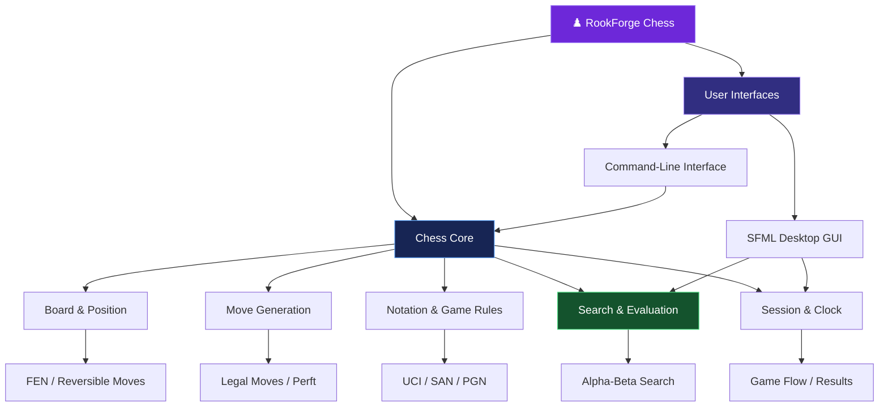
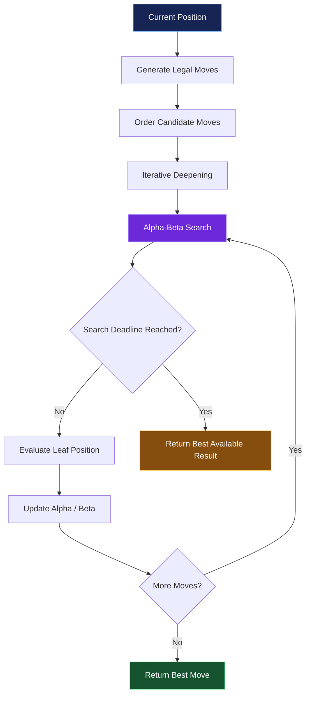
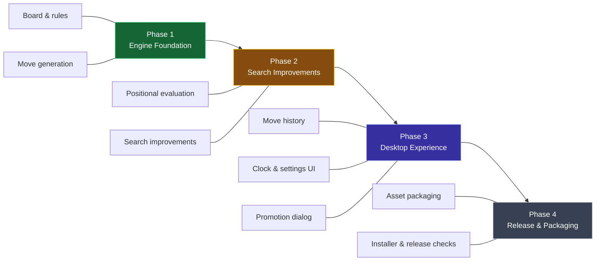

# ♟️ RookForge Chess

<p align="center">
  
  
  
  
</p>

<h3 align="center">
  ⚔️ Think Deep. Calculate Further. Rule the Board.
</h3>

<p align="center">
  A C++20 chess-engine project built around legal move generation, search algorithms,
  game-state management, and an optional SFML desktop interface.
</p>

<p align="center">
  <a href="#-features">Features</a> •
  <a href="#-architecture">Architecture</a> •
  <a href="#-getting-started">Getting Started</a> •
  <a href="#-roadmap">Roadmap</a> •
  <a href="#-contributing">Contributing</a>
</p>

---

## 🚧 Project Status: Work in Progress

**RookForge Chess is actively under development.**

The foundational chess engine, command-line interface, search opponent, and game-management APIs are implemented to varying degrees. The graphical interface and overall desktop experience are still being developed.

The current implementation is a work in progress, not a finished chess product. Features may change as the engine and application evolve.

> ♜ The objective: build a modular chess engine in modern C++, then evolve it into a polished desktop chess application.

---

## 🧠 What Is RookForge?

RookForge is a modular chess-engine project written in **C++20**. It separates the chess rules and game logic from the interface, allowing the engine to be used through a command-line interface or an optional SFML desktop board.

The project currently includes:

- A chess board and legal move-generation core.
- Standard chess rules, including castling, en passant, and promotions.
- FEN and UCI/SAN notation support.
- Iterative-deepening alpha-beta search with a deadline.
- A command-line interface for analysis and gameplay.
- Game sessions, repetition tracking, clocks, and result handling.
- An optional graphical board with basic interaction.
- Automated tests and CMake-based builds.

RookForge is designed with modularity and extensibility in mind. Its search evaluation currently uses material only, so its playing strength should not be assumed to match established chess engines.

## ⚔️ Features

| Feature | Current status |
|---|---|
| C++20 engine core | Implemented |
| Board representation and FEN | Implemented |
| Legal move generation | Implemented |
| Castling and en passant | Implemented |
| All four promotion types in the core | Implemented |
| Reversible moves and perft/divide | Implemented |
| Alpha-beta search with iterative deepening | Implemented |
| Search deadline and cancellable worker | Implemented |
| UCI/SAN notation | Implemented |
| Basic PGN import/export | Implemented |
| Repetition tracking and game results | Implemented |
| Command-line interface | Implemented |
| Basic SFML board interface | Available when enabled and dependencies are installed |
| Move history and clock/settings UI | Planned |
| Drag-and-drop movement | Planned |
| Promotion-choice dialog | Planned |
| Full desktop asset packaging and installer | Planned |
| Advanced position evaluation | Planned |

*Status describes the current project scope, not a claim that every feature has been independently benchmarked or fully validated.*

---

## 🏗️ Architecture

RookForge separates the engine, search logic, game flow, and presentation layer.



### Design principles

- **Separation of concerns:** Core chess logic does not depend on the graphical interface.
- **Modern C++:** C++20 provides the language foundation.
- **Testability:** The CLI and engine can be built without graphical dependencies.
- **Extensibility:** Search, evaluation, and interface capabilities can evolve independently.
- **Reproducibility:** CMake and CTest provide a consistent build and testing workflow.

## ♜ How the Search Engine Works

The search engine explores candidate moves and uses alpha-beta pruning to reduce unnecessary exploration. Iterative deepening allows it to search progressively deeper while respecting a deadline.



### Current evaluation limitations

The evaluator is currently **material-only**. Advanced positional features such as piece-square tables, mobility evaluation, and king-safety analysis are not yet implemented.

Consequently, the search infrastructure should not be confused with a claim of competitive playing strength.

---

## 🛠️ Tech Stack

<p>
  
  
  
  
  
</p>

| Technology | Purpose |
|---|---|
| C++20 | Engine and application implementation |
| CMake 3.24+ | Build configuration |
| SFML 3.0.2 | Optional graphical interface |
| GoogleTest | Optional unit testing framework |
| CTest | Test execution |
| Ninja | Optional build-system generator |

---

## 📂 Project Structure

```text
RookForge/
├── include/
│   └── chess/              # Public engine headers
├── src/
│   ├── core/               # Board, rules, search, notation
│   ├── gui/                # Optional SFML desktop interface
│   └── cli/                # Command-line application
├── tests/                  # Engine and application tests
├── assets/                 # Application assets
├── scripts/                # Build and packaging scripts
├── CMakeLists.txt          # Main build configuration
├── README.md
└── LICENSE
```

The exact contents may evolve as the project develops.

---

## 🚀 Getting Started

### Prerequisites

- A C++20-compatible compiler.
- CMake 3.24 or newer.
- Git.
- Ninja, if you choose the Ninja generator.
- SFML 3.0.2, if building the graphical interface.

### 1. Clone the repository

```bash
git clone https://github.com/sLasherGod10/Knightfall-Chess.git
cd Knightfall-Chess
```

> The GitHub repository is currently named `Knightfall-Chess`, while the project branding and local folder may still use `RookForge`. These names can be aligned later.

### 2. Configure the engine and CLI

The following configuration disables the GUI and enables the CLI and tests:

```bash
cmake -S . -B build \
  -DCHESS_BUILD_GUI=OFF \
  -DCHESS_BUILD_CLI=ON \
  -DCHESS_BUILD_TESTS=ON
```

### 3. Build

```bash
cmake --build build --config Release
```

### 4. Run tests

```bash
ctest --test-dir build --output-on-failure
```

### 5. Run the CLI

On Linux or macOS:

```bash
./build/rookforge_cli --help
```

On Windows:

```powershell
.\build\rookforge_cli.exe --help
```

Try a perft calculation:

```bash
./build/rookforge_cli perft 4
```

On Windows, replace the executable path with `.\build\rookforge_cli.exe`.

*CLI command availability and executable paths depend on the current build configuration.*

### 6. Build the graphical interface

Install SFML 3.0.2 and configure the project with GUI support:

```bash
cmake -S . -B build \
  -DCHESS_BUILD_GUI=ON \
  -DCHESS_BUILD_CLI=ON \
  -DCHESS_BUILD_TESTS=ON
```

Then build:

```bash
cmake --build build --config Release
```

The current GUI supports basic board interaction, legal-move indicators, queen promotion, AI toggling, restart, undo, and board flipping. Its controls and presentation remain under development.

---

## 🧪 Testing & Reliability

RookForge includes testing support for the engine and its core functionality.

Current testing infrastructure includes:

- CMake-based test configuration.
- CTest integration.
- Optional GoogleTest integration.
- Dependency-free assertions when GoogleTest is unavailable.
- Perft and divide commands for move-generation analysis.

GoogleTest can be used when installed or when dependency fetching is enabled with `CHESS_FETCH_DEPS=ON`.

**Note:** The existence of test infrastructure does not imply that every platform, feature, or release configuration has been verified. Run the test suite locally before relying on a particular build.

---

## 🗺️ Roadmap



### Planned improvements

- [ ] Improve positional evaluation.
- [ ] Add piece-square tables and mobility evaluation.
- [ ] Improve king-safety analysis.
- [ ] Add move history to the graphical interface.
- [ ] Introduce clock and settings controls.
- [ ] Add drag-and-drop piece movement.
- [ ] Implement a promotion-choice dialog.
- [ ] Improve PGN import/export, including variations and comments.
- [ ] Add FEN/PGN dialogs and file controls.
- [ ] Add resign and draw controls to the GUI.
- [ ] Improve visual assets and board presentation.
- [ ] Complete packaging and installer integration.
- [ ] Expand automated testing and platform verification.

*The roadmap is a development plan; completion dates and release milestones have not been committed.*

---

## 📦 Packaging

The project includes a Windows packaging script:

```powershell
.\scripts\package-windows.ps1
```

The script builds and tests the core/CLI. It requires CMake and a working C++ toolchain.

A complete desktop installer is not currently available, and release packages have not been verified. Installer generation, asset bundling, and release validation remain part of the development work.

---

## 🤝 Contributing

RookForge is a work in progress, and improvements to its engine, tests, documentation, and graphical interface are welcome.

A useful contribution workflow:

1. Fork the repository.
2. Create a feature branch.
3. Make a focused change.
4. Build the project and run the relevant tests.
5. Submit a pull request describing the change and its verification.

Example:

```bash
git checkout -b feature/positional-evaluation
git add .
git commit -m "Add positional evaluation improvements"
git push -u origin feature/positional-evaluation
```

---

## 📜 License

This project is licensed under the MIT License. See [LICENSE](LICENSE) for details.

No third-party runtime assets are currently included according to the current project documentation.

---

<p align="center">
  <strong>♟️ ROOKFORGE CHESS</strong>
  <br/>
  <em>Built one move at a time.</em>
  <br/><br/>
  <sub>Work in progress • C++20 • Chess Engine Development</sub>
</p>
